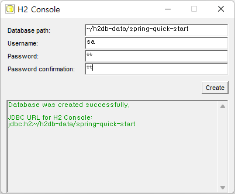

# spring-quick-start

## Spring Quick Start 도서의 스터디/실습 진행. (저자: 채규태 님)


### 도서 판매처

* yes24
  * http://www.yes24.com/Product/Goods/29173715

* 교보문고
  * https://www.kyobobook.co.kr/product/detailViewKor.laf?barcode=9791186710074


### 전체 빌드 테스트

```bash
$ mvnw clean test
```


### 게시판 웹 프로젝트 실행

```bash
$ cd BoardWeb
$ mvnw clean jetty:run
```


### 테스트 수행시 H2 DB가 서버 모드로 켜져있어야하는 프로젝트

이번에 h2 버전업 하면서 모든 프로젝트가 H2 DB 서버모드로 사용되도록 수정했습니다. (h2 DB서버가 미리 켜져있어야함.)

* hosts파일에 다음 내용 추가 ( linux:`/etc/hosts` 또는 windows: `%WINDIR%\System32\Drivers\etc\hosts` )

  ```
  127.0.0.1    h2db-host
  ```

* Database path:`~/h2db-data/spring-quick-start`

* Username, Password, Password confimation: `sa`

  

* 프로젝트 실행 전에 미리 데이터베이스를 만들어 놓고, h2 DB가 실행중이여야합니다.
  * BoardWeb
    * user 테이블: 스키마 생성, 데이터 입력 쿼리는 프로젝트에 내장되어있고 자동 실행
    * board 테이블: JPA에 의해 자동 생성
  * jpa-project
    * board 테이블: JPA에 의해 자동생성
  * mybatis-project
    * board 테이블: 스키마 생성, 데이터 입력 쿼리는 프로젝트에 내장되어있고 자동 실행


## 기타 

* log4j 디펜던시 검사
  * `mvnw dependency:list | findstr log4j`
